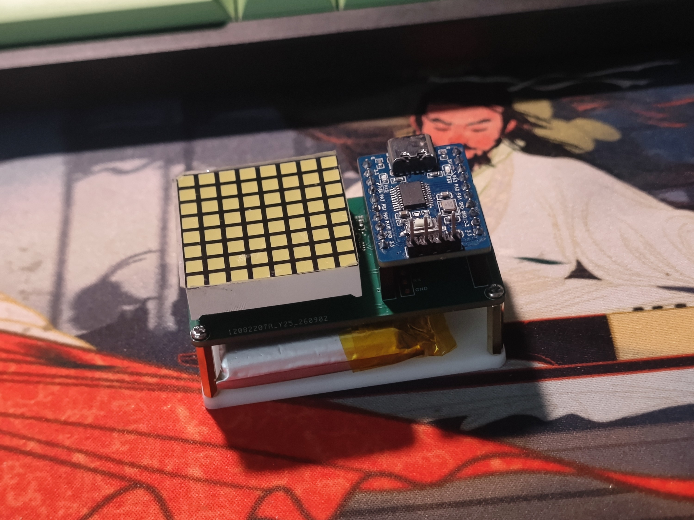
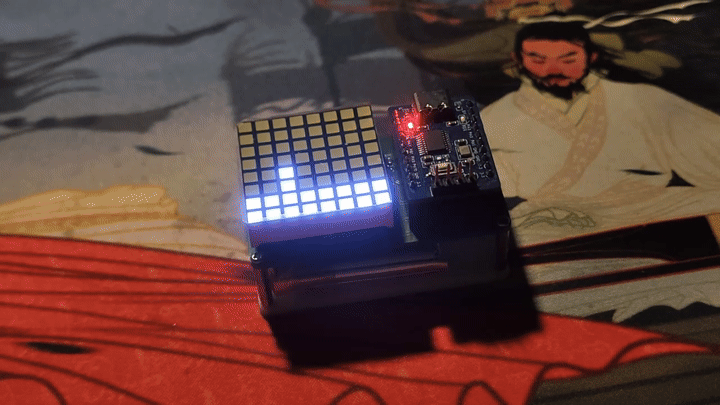
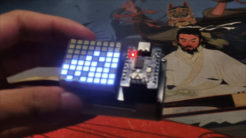
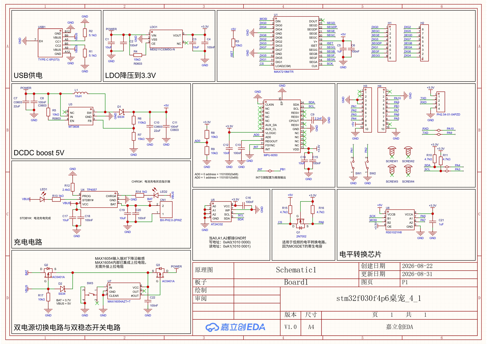

# STM32F030F4P6_MAX7219_LED阵列

## 目录
- [一、概述](#一概述)
- [二、功能特性](#二功能特性)
- [三、硬件电路](#三硬件电路)
- [四、软件程序](#四软件程序)
- [五、下载固件](#五下载固件)
- [六、声明](#六声明)

## 一、概述
### 描述
&emsp;&emsp;本项目使用stm32f030f4p6为主控，使用MAX7219作为LED阵列驱动，使用MPU6050检测加速度。硬件上包含双电源切换电路、电平转换电路、DCDC boost电路、TP4057锂电池充电电路等。<br>
&emsp;&emsp;主要功能：使用 8×8 LED 点阵用于显示点阵画面；内置 MPU6050，能够感知板子的摆放姿态，并让点阵粒子像液体一样随重力流动。
### 预览




## 二、功能特性
### 按键逻辑     
| 触发 | 结果 |
| :--- | :--- |
| 单击 KEY3 | 开关机|
| 短按 KEY1 | 点阵全亮 |
| 短按 KEY2 | 回到默认显示 / 切换子页面 |
| 长按 KEY1 3 秒 | 进入流体模拟 |
| 再次长按 KEY1 3 秒 | 回到默认显示画面 |
## 三、硬件电路
### 原理图

### STM32F030F4P6引脚定义
|引脚|功能|
|:---|:---|
| PA0 | 指示灯|
| PA1 | KEY1 |
| PA2 | KEY2|
| PA3 | I2C SCL|
| PA4 | I2C SDA|
| PA5 | SPI SCK|
| PA6 | SPI CS|
| PA7 | SPI MOSI|
| PB1 | INT |
| PA9 | TX(预留) |
| PA10| RX(预留) |

### BOM [（点此下载）](https://raw.githubusercontent.com/FiberAndFiber/stm32f030f4p6_MAX7219_LED/main/hardware/BOM_stm32f030f4p6_MAX7219_LED%E9%98%B5%E5%88%97.xlsx)
| ID | Name | Designator | Footprint | Quantity | Manufacturer Part | Manufacturer | Supplier | Supplier Part |
|:---|:-----|:-----------|:----------|:---------|:------------------|:-------------|:---------|:--------------|
| 1 | 1kΩ | R13,R14 | R0603 | 2 | FRC0603F1001TS | FOJAN(富捷) | LCSC | C2907002 |
| 2 | 2.4kΩ | R12 | R0603 | 1 | 0603WAF2401T5E | UNI-ROYAL(厚声) | LCSC | C22940 |
| 3 | 4.7kΩ | R10,R11,R16,R15 | R0603 | 4 | RC0603FR-074K7L | YAGEO(国巨) | LCSC | C99782 |
| 4 | 5.1kΩ | R2,R1 | R0603 | 2 | 0603WAF5101T5E | UNI-ROYAL(厚声) | LCSC | C23186 |
| 5 | 10kΩ | R4,R5,R3,R8,R9,R17 | R0603 | 2 | FRC0603F1002TS | FOJAN(富捷) | LCSC | C2906982 |
| 6 | 15kΩ | R7 | R0603 | 1 | 0603WAF1502T5E | UNI-ROYAL(厚声) | LCSC | C22809 |
| 7 | 110kΩ | R6 | R0603 | 1 | 0603WAF1103T5E | UNI-ROYAL(厚声) | LCSC | C25805 |
| 8 | 2.2nF | C9 | C0603 | 1 | CL10B222KB8NNNC | SAMSUNG(三星) | LCSC | C16033 |
| 9 | 10nF | C12 | C0603 | 1 | CGA0603X7R103K500JT | HRE(芯声) | LCSC | C7503504 |
| 10 | 100nF | C18,C20,C2,C4,C8,C11,C15,C13,C6,C16,C22 | C0603 | 11 | CGA0603X7R104K500JT | HRE(芯声) | LCSC | C6119867 |
| 11 | 1uF | C5,C21 | C0603 | 2 | CL10B105KP8NNNC | SAMSUNG(三星) | LCSC | C95843 |
| 12 | 10uF | C19,C17,C1,C3,C14 | C0603 | 5 | CL10A106KP8NNNC | SAMSUNG(三星) | LCSC | C19702 |
| 13 | 22uF | C7,C10 | C0603 | 2 | CGA0603X5R226M160JT | HRE(芯声) | LCSC | C6119868 |
| 14 | TYPE-C 6P(073) | USB1 | TYPE-C-SMD_TYPE-C-6P-073 | 1 | TYPE-C 6P(073) | SHOU HAN(首韩) | LCSC | C668623 |
| 15 | TP4057 | U4 | SOT-23-6_L2.9-W1.6-P0.95-LS2.8-BR | 1 | TP4057 | UMW(友台半导体) | LCSC | C725791 |
| 16 | NCD0603R1 | LED2 | LED0603-RD_RED | 1 | NCD0603R1 | 国星光电 | LCSC | C84263 |
| 17 | NCD0603B1 | LED1 | LED0603-RD | 1 | NCD0603B1 | 国星光电 | LCSC | C84266 |
| 18 | ME6211C33M5G-N | LDO1 | SOT-23-5_L3.0-W1.7-P0.95-LS2.8-BL | 1 | ME6211C33M5G-N | MICRONE(南京微盟) | LCSC | C82942 |
| 19 | MAX7219M/TR | U1 | SOP-24_L15.4-W7.5-P1.27-LS10.4-BL | 1 | MAX7219M/TR | HGSEMI(华冠) | LCSC | C6705351 |
| 20 | MT3608 | U3 | SOT-23-6_L2.9-W1.6-P0.95-LS2.8-BL | 1 | MT3608 | 西安航天民芯 | LCSC | C84817 |
| 21 | 10uH | L1 | IND-SMD_L4.6-W4.1 | 1 | SRG0420-100-M | JIERR(捷而瑞) | LCSC | C53462920 |
| 22 | SS34 | D1,D2 | SMA_L4.3-W2.6-LS5.0-FD | 2 | SS34 | R+O(宏嘉诚) | LCSC | C7420365 |
| 23 | AO3401A | Q2,Q3 | SOT-23_L2.9-W1.3-P1.90-LS2.4-BR | 2 | AO3401A | UMW(友台半导体) | LCSC | C347476 |
| 24 | PH2.54-01-04PZD | H5 | HDR-TH_4P-P2.54-V-M-1 | 1 | PH2.54-01-04PZD | XUNPU(讯普) | LCSC | C7501582 |
| 25 | AT24C02 | U5 | SOP-8_L5.0-W4.0-P1.27-LS6.0-BL | 1 | AT24C02 | IDCHIP(英锐芯) | LCSC | C688857 |
| 26 | MF254V-11-08-0743 | H2,H1 | HDR-TH_8P-P2.54-V-F_MF254V-11-08-0743 | 2 | MF254V-11-08-0743 | XFCN(兴飞) | LCSC | C2889989 |
| 27 | PM254-1-10-Z-8.5 | H3,H4 | HDR-TH_10P-P2.54-V-F | 2 | PM254-1-10-Z-8.5 | HCTL(华灿天禄) | LCSC | C2897373 |
| 28 | MPU-6050 | U2 | QFN-24_L4.0-W4.0-P0.50-BL-EP2.7 | 1 | MPU-6050 | TDK InvenSense(应美盛) | LCSC | C24112 |
| 29 | TS-1101-B-W | SW1,SW2 | KEY-SMD_2P-L6.0-W3.6-P7.4-LS8.0-L | 2 | TS-1101-B-W | XKB Connection(中国星坤) | LCSC | C500065 |
| 30 | 2N7002 | Q1 | SOT-23-3_L2.9-W1.3-P1.90-LS2.4-BR | 1 | 2N7002 | CJ(江苏长电/长晶) | LCSC | C8545 |
| 31 | RS0102YH8 | U6 | SOT-23-8_L3.0-W1.7-P0.65-LS2.8-BL | 1 | RS0102YH8 | RUNIC(润石) | LCSC | C783414 |
| 32 | BX-PH2.0-2PWZ | CN1 | CONN-TH_2P-P2.00_BX-PH2.0-2PWZ | 1 | BX-PH2.0-2PWZ | Bossie(博锡) | LCSC | C18077753 |
| 33 | TS-1187A-B-A-B | SW3 | SW-SMD_4P-L5.1-W5.1-P3.70-LS6.5-TL_H1.5 | 1 | TS-1187A-B-A-B | XKB Connection(中国星坤) | LCSC | C318884 |
| 34 | MAX16054AZT+T | U7 | TSOT-23-6_L2.9-W1.6-P0.95-LS2.8-TL | 1 | MAX16054AZT+T | ADI(亚德诺) | LCSC | C79401 |

## 四、软件程序
- MAX7219点阵驱动
- 流体粒子算法
- 状态机实现页面切换

### 4.1 MAX7219点阵驱动
#### 4.1.1 MAX7219寄存器表
| 地址 | 宏定义 | 名称 | 说明 |
|------|--------|------|------|
| `0x00` | `MAX7219_REG_NOOP` | 空操作 | 写它不产生任何效果，用于多片级联时跳过某片 |
| `0x01`~`0x08` | `MAX7219_REG_DIGIT0`~`DIGIT7` | 数字 0~7 | 8 个位数据寄存器，每一位对应一个段/列 |
| `0x09` | `MAX7219_REG_DECODE` | 译码模式 | 每个位是否为 BCD 译码（本工程用 0x00 = 全不译码） |
| `0x0A` | `MAX7219_REG_INTENSITY` | 亮度 | 低 4 位有效，0~15 级 PWM 亮度 |
| `0x0B` | `MAX7219_REG_SCAN_LIMIT` | 扫描限制 | 显示几行（0~7 对应 1~8 行，本工程用 0x07 = 8 行全扫描） |
| `0x0C` | `MAX7219_REG_SHUTDOWN` | 关断模式 | 0x00 = 关断，0x01 = 正常工作 |
| `0x0F` | `MAX7219_REG_TEST` | 显示测试 | 0x01 = 全亮测试，0x00 = 正常 |

#### 4.1.2 STM32F030F4P6 与 MAX7219 的通信

本工程**没有使用 STM32 的硬件 SPI 外设**，而是用 GPIO 模拟（bit-banging）的方式实现软件SPI，实现于 `/software/Demo/User/src/SOFT_SPI_DRIVER.c`。

**引脚定义**（`SOFT_SPI_DRIVER.c:8-13` 注释）：

| MAX7219 引脚 | STM32 引脚 | 方向 | 作用 |
|--------------|-----------|------|------|
| DIN（数据） | **PA7** | MCU→7219 | 串行数据（MOSI） |
| CLK（时钟） | **PA5** | MCU→7219 | 串行时钟（SCK） |
| CS/LOAD（锁存） | **PA6** | MCU→7219 | 片选/锁存 |

**GPIO 初始化**（`SOFT_SPI_DRIVER_INIT`，`SOFT_SPI_DRIVER.c:31-45`）：
- 使能 GPIOA 时钟
- PA5/PA6/PA7 配置为 **推挽输出、50MHz、无上下拉**
- 初始状态：CS 拉高（无效）、SCK 拉低

**发送 1 个字节**（`SOFT_SPI_DRIVER_SendByte`，`SOFT_SPI_DRIVER.c:57-69`）——这是通信核心：

```c
void SOFE_SPI_DRIVER_SendByte(uint8_t ByteSend)
{
    uint8_t i;
    for (i = 0; i < 8; i++)
    {
        SOFE_SPI_DRIVER_MOSI(!!(ByteSend & (0x80 >> i)));  // 先送最高位(MSB)
        Delay_us(1);
        SOFE_SPI_DRIVER_SCK(1);                            // SCK 上升沿
        Delay_us(1);
        SOFE_SPI_DRIVER_SCK(0);                            // SCK 下降沿
        Delay_us(1);
    }
}
```

- 数据 **MSB 先行**（从 bit7 到 bit0）。
- 每个 bit：先把 MOSI 置成对应电平 → SCK 拉高（上升沿，MAX7219 在此采样数据）→ SCK 拉低。
- 这符合 SPI **模式 0**（CPOL=0，时钟空闲低电平；CPHA=0，上升沿采样）。
- 每步 `Delay_us(1)` 提供稳定时序（MAX7219 最高时钟 10MHz，软件 SPI 远低于此，非常安全）。

**一帧 16 位传输**（`MAX7219_Send16`，`MAX7219.c:21-27`）：

```c
static void MAX7219_Send16(uint8_t addr, uint8_t data)
{
    SOFE_SPI_DRIVER_START();          // CS 拉低，开始一帧
    SOFE_SPI_DRIVER_SendByte(addr);   // 先发 8 位寄存器地址
    SOFE_SPI_DRIVER_SendByte(data);   // 再发 8 位数据
    SOFE_SPI_DRIVER_END();            // CS 拉高，锁存
}
```

MAX7219 的串行数据格式是 **16 位**：`D15~D8 = 寄存器地址`，`D7~D0 = 数据`。数据在 **CS 上升沿被锁存**（`SOFT_SPI_DRIVER_END` 把 CS 拉高）。所以一帧 = CS 拉低 → 连续发送 16 bit → CS 拉高。

> 片选/锁存的实现：
> - `SOFE_SPI_DRIVER_START()` = `CS=0`（`SOFT_SPI_DRIVER.c:47-50`）
> - `SOFE_SPI_DRIVER_END()`   = `CS=1`（`SOFT_SPI_DRIVER.c:52-55`）

#### 4.1.3 LED 亮灭控制的本质

MAX7219 内部通过 **动态扫描** 轮流点亮 8 个行（DIGIT0~DIGIT7），每个时刻只有一行被点亮，但刷新速度很快（约 800Hz），人眼看到的是完整的静态画面。

**点亮/熄灭一个 LED 的根本动作 = 向对应的 DIGIT 寄存器写入相应的 bit。**

- 在 8×8 点阵里，**物理像素 `(列 pCol, 行 pRow)` ↔ DIGIT(pRow) 寄存器 的 bit(7-pCol)**。
  - `pRow` 决定写哪个 DIGIT 寄存器（哪一行）。
  - `7-pCol` 决定这行 8 bit 中的哪一位（哪一列）。

例如：点亮第 0 行第 0 列的 LED = 向 `DIGIT0` 写入 `0x80`（bit7=1，其余 0）。

#### 4.1.4 帧缓冲（Framebuffer）设计

工程用了一个 **8 字节的逻辑帧缓冲** 来抽象屏幕，见 `MAX7219.c:13`：

```c
static uint8_t MAX7219_FB[8];
```

- `FB[row]` 的 `bit(7-col)` 对应逻辑像素 `(col, row)`。
- **左上角 = (0,0)**，col=0~7（横），row=0~7（纵）。
- 所有绘图函数（画点、画字符、画图）都只在逻辑坐标系上操作，**不关心物理方向**。
- 方向变换（旋转/镜像）统一在 `MAX7219_Flush()` 里完成。

#### 4.1.5 初始化流程（`MAX7219_Init`，`MAX7219.c:139-155`）

```c
SOFE_SPI_DRIVER_INIT();                               // 初始化 3 个 GPIO

MAX7219_Send16(MAX7219_REG_SHUTDOWN,   0x00);         // 1. 先关断
MAX7219_Send16(MAX7219_REG_TEST,        0x00);         // 2. 关闭测试模式
MAX7219_Send16(MAX7219_REG_SCAN_LIMIT,  0x07);         // 3. 扫描 8 行（全屏）
MAX7219_Send16(MAX7219_REG_DECODE,      0x00);         // 4. 不译码（点阵模式）
MAX7219_Send16(MAX7219_REG_INTENSITY,   0x01);         // 5. 亮度等级 1
MAX7219_Send16(MAX7219_REG_SHUTDOWN,    0x01);         // 6. 正常工作

MAX7219_Orientation = ORIENT_NORMAL;                  // 方向默认正常
for (i = 0; i < 8; i++) MAX7219_FB[i] = 0x00;          // 清空帧缓冲
MAX7219_Flush();                                       // 刷新（清屏）
```

#### 4.1.6 方向变换（`MAX7219_Flush`，`MAX7219.c:36-94`）

这是把**逻辑帧缓冲**映射到**物理 DIGIT 寄存器**并发送的核心。逻辑坐标系永远固定（左上角 (0,0)），只有这里做坐标变换：

```c
static void MAX7219_Flush(void)
{
    uint8_t pRow, pCol;        // 物理行列
    uint8_t logRow, logCol;    // 逻辑行列
    uint8_t physFB[8] = {0};   // 物理帧缓冲

    for (pRow = 0; pRow < 8; pRow++)
        for (pCol = 0; pCol < 8; pCol++)
        {
            /* 根据方向，把物理坐标映射回逻辑坐标 */
            switch (MAX7219_Orientation) { ... }

            /* 从逻辑 framebuffer 取像素，写入物理 framebuffer */
            if (MAX7219_FB[logRow] & (0x80 >> logCol))
                physFB[pRow] |= (0x80 >> pCol);
        }

    /* 把物理帧缓冲发送到 MAX7219 */
    for (pRow = 0; pRow < 8; pRow++)
        MAX7219_Send16(MAX7219_REG_DIGIT0 + pRow, physFB[pRow]);
}
```

支持的 6 种方向（`MAX7219.h:24-29`）：

| 方向 | 映射关系 | 描述 |
|------|----------|------|
| `ORIENT_NORMAL` | `logCol=pCol, logRow=pRow` |常规方向|
| `ORIENT_ROTATE_90` | `logCol=pRow, logRow=7-pCol`|顺时针 90° |
| `ORIENT_ROTATE_180` | `logCol=7-pCol, logRow=7-pRow` |顺时针 180°|
| `ORIENT_ROTATE_270` | `logCol=7-pRow, logRow=pCol` |顺时针 270°|
| `ORIENT_MIRROR_H` | `logCol=7-pCol, logRow=pRow` |左右翻转|
| `ORIENT_MIRROR_V` | `logCol=pCol, logRow=7-pRow` |上下翻转|

使用MAX7219_SetOrientation();函数设置方向

#### 4.1.7 上层绘图 API

| 函数 | 位置 | 作用 |
|------|------|------|
| `MAX7219_POINT(x,y)` | `MAX7219.c:206` | 点亮单点（`FB[y] \|= 0x80>>x`） |
| `MAX7219_CLEARPOINT(x,y)` | `MAX7219.c:214` | 熄灭单点 |
| `MAX7219_SHOWNUM(x,y,n)` | `MAX7219.c:225` | 显示 0~9 数字（4 列宽） |
| `MAX7219_SHOWCHAR(x,y,ch)` | `MAX7219.c:253` | 显示 ASCII 字符（4 列宽） |
| `MAX7219_SHOWPICTURE(...)` | `MAX7219.c:299` | 显示图片 / 帧动画 |
| `MAX7219_DrawBuffer(buf[8])` | `MAX7219.c:195` | 直接把 8 字节缓冲区整屏刷出 |
| `MAX7219_SetBrightness(n)` | `MAX7219.c:164` | 亮度 0~15 |
| `Diag_Map()` | `MAX7219.c:342` | 逐行/逐列全亮的硬件自检 |

### 4.2 流体粒子算法
- 姿态解算
- 粒子移动计算
- 渲染
#### 4.2.1姿态解算
读 MPU6050 三轴加速度（`0x3B~0x40`），除以 2048 换算成 g（±16g 量程），经轴映射与符号修正（`GX_DIR`/`GY_DIR`/`HORIZ_USE_Z`）得到屏幕内"下/右"两个分量，再用一阶低通滤波（α=0.8）平滑，输出重力方向 `g_down`、`g_right`。

#### 4.2.2粒子移动计算
**数据表示**：屏幕是 8×8 格子，`grid[8][8]` 记录占用；粒子位置用 8.8 定点数 `ppx/ppy` 表示，高 8 位是格坐标（`>>8`）、低 8 位是格内亚像素，使粒子能在格间平滑移动。

```c
static int16_t ppx[FLUID_PARTICLE_MAX];   // 8.8 定点：高 8 位格坐标、低 8 位亚像素
static int16_t ppy[FLUID_PARTICLE_MAX];
static uint8_t grid[8][8];                // 占用表：1=该格已有粒子
```

**单个粒子移动 `Fluid_MoveOne`**：新位置 = 旧位置 + 步长，按落点分四种情形：

```c
int16_t nx = px + step_col;
int16_t ny = py + step_row;
int8_t nc = (int8_t)(nx >> 8);   // 目标格
int8_t nr = (int8_t)(ny >> 8);

if (nc == cc && nr == cr) { ppx[pi]=nx; ppy[pi]=ny; return; }       // ① 同格漂移
if (nc>=0 && nc<=7 && nr>=0 && nr<=7 && grid[nc][nr]==0) {          // ② 进入空格
    grid[cc][cr]=0; grid[nc][nr]=1; ppx[pi]=nx; ppy[pi]=ny; return;
}
```

①② 分别是"格内平滑漂移"和"正常下落/移动"。若目标格出界或已被占，进入 ③ 斜落：

```c
int8_t dCol = (step_col>0)?1:(step_col<0?-1:0);   // 重力方向符号
int8_t dRow = (step_row>0)?1:(step_row<0?-1:0);
// 垂直重力→左右斜落；水平重力→上下斜落；对角→拆成两轴分量
// rng()&1 随机交换候选顺序，让沙堆两侧堆积更自然
for (i=0; i<ns; i++) {                            // 依次试候选格，谁空滑到谁
    int8_t sc = cc+sd[i][0], sr = cr+sd[i][1];
    if (sc>=0 && sc<=7 && sr>=0 && sr<=7 && grid[sc][sr]==0) {
        grid[cc][cr]=0; grid[sc][sr]=1;
        ppx[pi]=(sc<<8)+128; ppy[pi]=(sr<<8)+128; return;   // 吸附到该格格心
    }
}
ppx[pi]=(cc<<8)+128; ppy[pi]=(cr<<8)+128;         // ④ 彻底卡死：吸附当前格心
```

③ 就是"沙子落在沙堆上向两侧滑"的关键——被挡后不原地卡死，而是沿重力方向斜滑一格；④ 两个候选格都被占时才停住。

**整步编排 `Fluid_Step`**：

```c
Fluid_UpdateAttitude();
mag2 = g_down*g_down + g_right*g_right;           // 平放判定
if (mag2 < FLUID_FLAT_G2) return;                 //   太平则不动

step_col = (int16_t)(g_right * FLUID_SPEED);      // 步长 = 重力 × 速度(256→1g≈1格)
step_row = (int16_t)(g_down  * FLUID_SPEED);

for (p=0; p<FLUID_PASSES; p++) {
    /* Fisher-Yates 洗牌，随机化粒子处理顺序 */
    for (i=0; i<n; i++) Fluid_MoveOne(order[i], step_col, step_row);
}
Fluid_Render();
```

- **平放判定**：重力矢量平方和 < `FLUID_FLAT_G2`(≈0.12g) 时不动，避免水平放置时粒子乱飘。
- **步长**：`FLUID_SPEED=256` 使 1g 分量对应 1 格，倾斜越陡步长越大、下落越快。
- **洗牌**：打乱处理顺序，避免固定顺序导致堆积有规律。

#### 4.2.3渲染
把每个粒子的格坐标（`ppx>>8`、`ppy>>8`）写入 8 字节位图，调 `MAX7219_DrawBuffer()` 一次性刷出。

### 4.3 状态机实现页面切换

用 `app_mode` 枚举记录三种显示状态，主循环每 10ms 读一次按键，按当前状态分发处理：

```c
typedef enum { MODE_DISPLAY = 0, MODE_ALL_ON, MODE_FLUID } AppMode;
static AppMode app_mode;

while (1)
{
    KeyEvent evt = Key_Scan();          // 读按键事件（短按/长按/无）

    switch (app_mode)
    {
    case MODE_DISPLAY:
        Display_PageTick();             // 推进当前子页面动画
        if      (evt == KEY1_SHORT) { app_mode = MODE_ALL_ON; Display_AllOn(); }
        else if (evt == KEY1_LONG)  { app_mode = MODE_FLUID;  Fluid_Init();    }
        else if (evt == KEY2_SHORT) { page_index++; ...; Display_PageShow();   }
        break;
    case MODE_ALL_ON:
        if      (evt == KEY2_SHORT) { app_mode = MODE_DISPLAY; Display_Default(); }
        else if (evt == KEY1_LONG)  { app_mode = MODE_FLUID;   Fluid_Init();     }
        break;
    case MODE_FLUID:
        Fluid_Step();               // 每拍推进一步流体模拟
        if      (evt == KEY1_LONG)  { app_mode = MODE_DISPLAY; Display_Default(); }
        else if (evt == KEY2_SHORT) { app_mode = MODE_DISPLAY; Display_Default(); }
        break;
    }
    Delay_ms(MAIN_TICK_MS);         // 10ms 节拍
}
```

**切换关系**：

| 当前状态 | 触发 | 目标状态 |
|:---|:---|:---|
| 显示 | 短按 KEY1 | 全亮 |
| 显示 | 长按 KEY1 | 流体 |
| 显示 | 短按 KEY2 | 切换子页面 |
| 全亮 | 短按 KEY2 | 显示 |
| 全亮 | 长按 KEY1 | 流体 |
| 流体 | 长按 KEY1 / 短按 KEY2 | 显示 |

**子页面机制**：`MODE_DISPLAY` 内部再用 `page_index` 管理多个子页面，`pages[]` 数组每项 = 帧数组 + 帧数 + 帧间隔：

```c
static const PageDef pages[] = {
    { JUMP,  ...,  350 },   // 页1：跳跃动画
    { HELLO, ...,  300 },   // 页2：Hello 动画
    { SMILE, ...,  0   },   // 页3：笑脸（静态，interval=0）
};
```

## 五、下载固件
Demo.bin[（点此下载）](https://raw.githubusercontent.com/FiberAndFiber/stm32f030f4p6_MAX7219_LED/main/firmware/Demo.bin)<br>
Demo.hex[（点此下载）](https://github.com/FiberAndFiber/stm32f030f4p6_MAX7219_LED/blob/refs/heads/main/firmware/Demo.hex)

## 六、声明
OpenPower STM32F030F4P6_MAX7219_LED阵列 © 2026 Ma WenBin

本设计文件采用 [TAPR 非商业硬件许可协议 v1.0](https://files.tapr.org/OHL/TAPR_Noncommercial_Hardware_License_v1.0.txt)(TAPR Noncommercial Hardware License v1.0) 授权。

- Copyright 2007 TAPR
- 许可全文:https://files.tapr.org/OHL/TAPR_Noncommercial_Hardware_License_v1.0.txt
- 可自由复制、修改、分发本设计,但须保留本版权与许可声明,且不得用于商业目的。

<br>
本项目仅供个人学习、研究和非商业用途。严禁任何个人或实体将本项目及其衍生品用于商业销售、盈利活动。

- 本设计仅供参考与学习，未经量产验证，不保证正确性与完整性；使用者须自行校验，因使用本设计造成的任何损失由使用者自行承担。
- 引用、转载或二次开发时请保留原始出处并注明作者；衍生作品须延续上述非商业使用限制。

